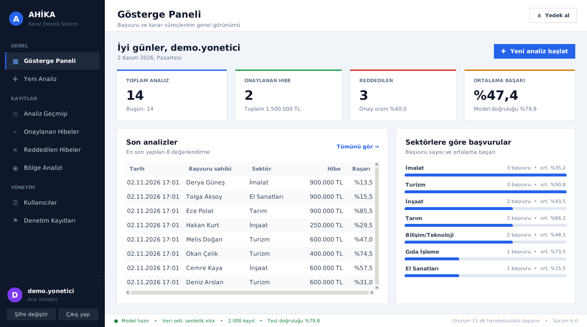
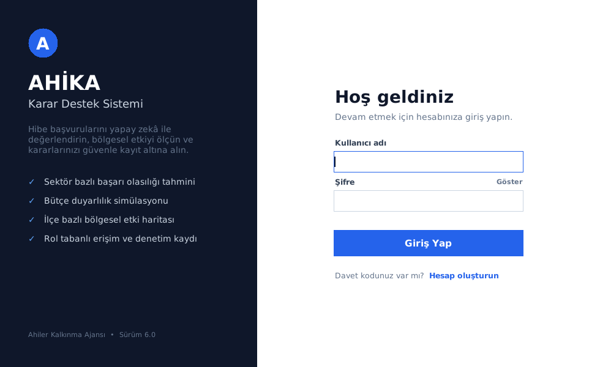
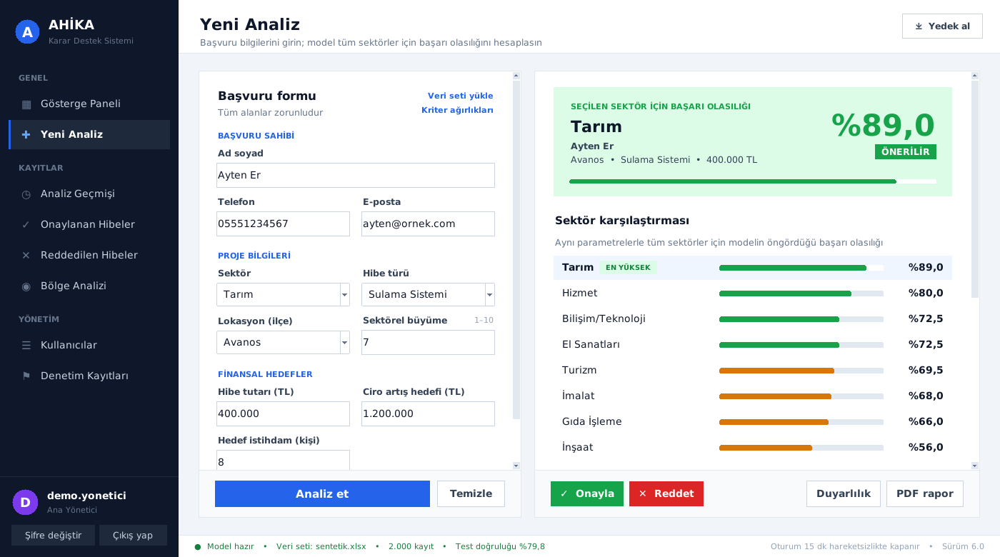
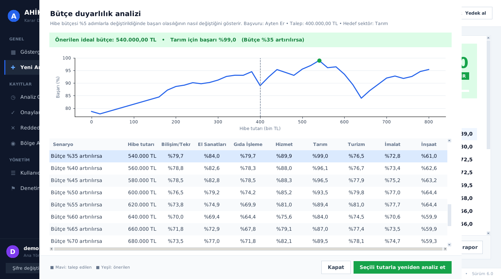
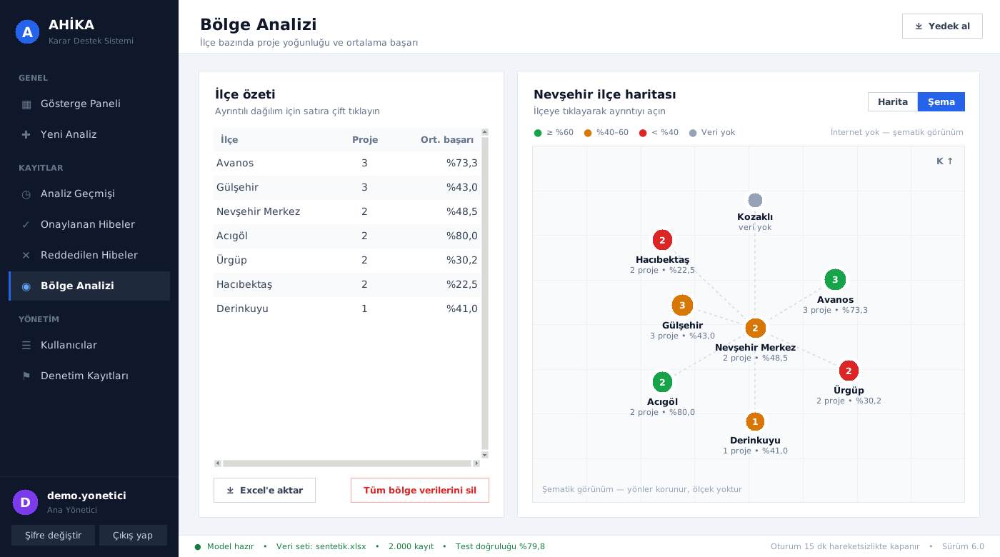
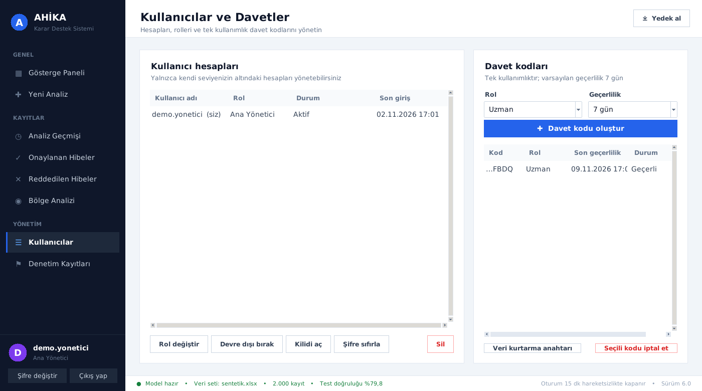
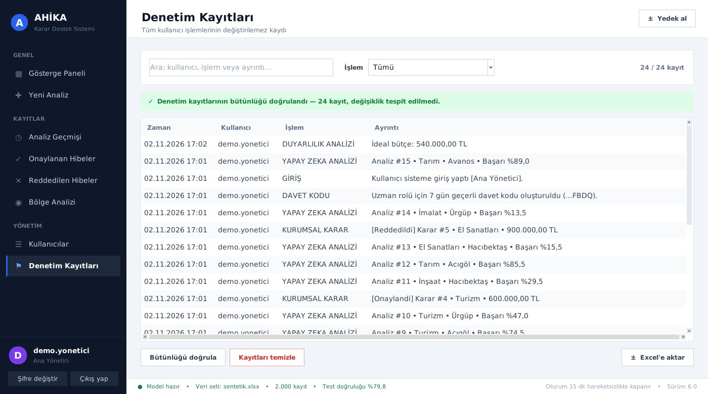

# AHİKA Karar Destek Sistemi

Ahiler Kalkınma Ajansı (AHİKA) için geliştirilmiş, hibe başvurularını yapay zekâ ile değerlendiren masaüstü **karar destek sistemi**. Başvuru bilgilerinden her sektör için başarı olasılığını tahmin eder, bütçe senaryolarını simüle eder, ilçe bazında bölgesel etkiyi gösterir ve kararları denetlenebilir biçimde kayıt altına alır.



> **Not:** Model, depodaki `sentetik.xlsx` dosyasındaki **sentetik (yapay) veriyle** eğitilmiştir. Gerçek kararlarda kullanılmadan önce ajansın gerçek geçmiş verisiyle yeniden eğitilmelidir. Ekran görüntülerindeki kişi adları uydurmadır.

## Özellikler

**Analiz ve karar destek**
- Random Forest sınıflandırıcısı ile sektör bazında hibe başarı olasılığı tahmini (8 sektör, 8 ilçe, 15 hibe türü)
- Ciro/hibe katsayısı, istihdam etkisi ve sektörel büyümeye dayalı risk uyarıları
- **Bütçe duyarlılık analizi:** hibe tutarı %5 adımlarla değiştirildiğinde başarının nasıl değiştiğini gösteren grafik ve önerilen ideal bütçe
- İki başvuruyu yan yana karşılaştırma
- Modelin kriter ağırlıklarını gösteren grafik
- Uygulama içinden yeni veri seti yükleyip modeli yeniden eğitme

**Raporlama**
- Türkçe karakter destekli PDF analiz ve karşılaştırma raporları
- Excel'e dışa aktarma (formül enjeksiyonuna karşı korumalı)
- Gösterge paneli: toplam analiz, onay/ret sayıları, ortalama başarı, sektör dağılımı

**Bölge analizi**
- Nevşehir ilçelerine göre proje yoğunluğu ve ortalama başarı
- Bir kez indirilip saklanan, internetsiz de çalışan harita ve şematik ilçe görünümü

**Güvenlik ve KVKK**
- Şifreler PBKDF2-HMAC-SHA256 ve kullanıcıya özel tuz ile saklanır (düz metin tutulmaz)
- 5 hatalı denemede 15 dakikalık hesap kilidi, 15 dakika hareketsizlikte otomatik oturum kapatma
- 4 rollü yetkilendirme: Ana Yönetici, Yönetici, Uzman, Stajyer (Stajyer karar veremez, kişisel veriyi maskeli görür)
- Tek kullanımlık, süreli davet kodlarıyla kullanıcı kaydı
- Başvuru sahiplerinin ad, telefon ve e-posta bilgileri veritabanında **şifreli** (Fernet/AES); anahtar Windows DPAPI ile bilgisayara bağlı, ayrıca kurtarma anahtarı var
- Hash zincirli denetim kayıtları: kayıtlar uygulama dışından değiştirilirse tespit edilir
- Otomatik yedekleme (son 30 yedek saklanır)

## Ekran görüntüleri

| Giriş | Yeni analiz |
|---|---|
|  |  |

| Bütçe duyarlılık analizi | Bölge analizi |
|---|---|
|  |  |

| Kullanıcılar ve davet kodları | Denetim kayıtları |
|---|---|
|  |  |

## Mimari

```
analiz.py     Arayüz (Tkinter): giriş, gösterge paneli, analiz, kayıt listeleri, bölge, yönetim ekranları
motor.py      Yapay zekâ modeli, kayıt sorguları, PDF/Excel raporlama (arayüzden bağımsız)
guvenlik.py   Kimlik doğrulama, yetkilendirme, şifreleme, denetim günlüğü, yedekleme, veritabanı göçleri
```

Veriler yerel bir SQLite veritabanında tutulur. Veritabanı şeması sürümlüdür; eski sürümlerden gelen veritabanları ilk açılışta otomatik olarak güncellenir.

## Kurulum ve çalıştırma

Python 3.10 veya üzeri gerekir.

```bash
pip install -r requirements.txt
python analiz.py
```

İlk açılışta sistemi yönetecek **Ana Yönetici** hesabı oluşturulur. Diğer kullanıcılar, yöneticinin oluşturduğu davet kodlarıyla kayıt olur.

### Windows için .exe oluşturma

`derle.bat` dosyasını çalıştırmak yeterlidir: gerekli paketleri kurar, PyInstaller ile derler ve `AHİKA KDS.exe` dosyasını oluşturur.

## Veri seti biçimi

Model eğitimi için Excel dosyasında şu sütunlar bulunmalıdır:

`sektör`, `Hibe_Tutari`, `Istihdam_Artisi`, `Ciro_Artisi`, `Lokasyon`, `Sektorel_Buyume_Endeksi`, `Hibe_Turu`, `Basari_Durumu` (0/1)

## Kullanılan teknolojiler

Python · scikit-learn · pandas · Tkinter · SQLite · matplotlib · ReportLab · openpyxl · cryptography · tkintermapview · PyInstaller

---

## English summary

A desktop **decision support system** built for the Ahiler Development Agency (Türkiye) to evaluate grant applications. It predicts the success probability of a grant for each sector with a Random Forest model, simulates budget scenarios, visualises district-level impact, and keeps an auditable record of decisions. It also includes role-based access control, hashed passwords, encrypted personal data (KVKK / Turkish GDPR), and a tamper-evident audit log. The model is trained on a **synthetic** dataset included in the repository.

**Geliştiren:** Umay Hüma Çetin
